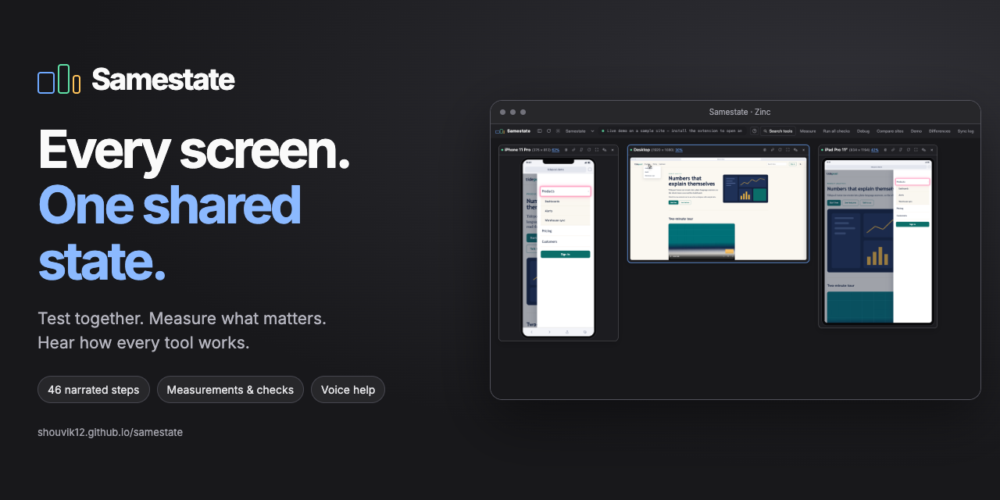
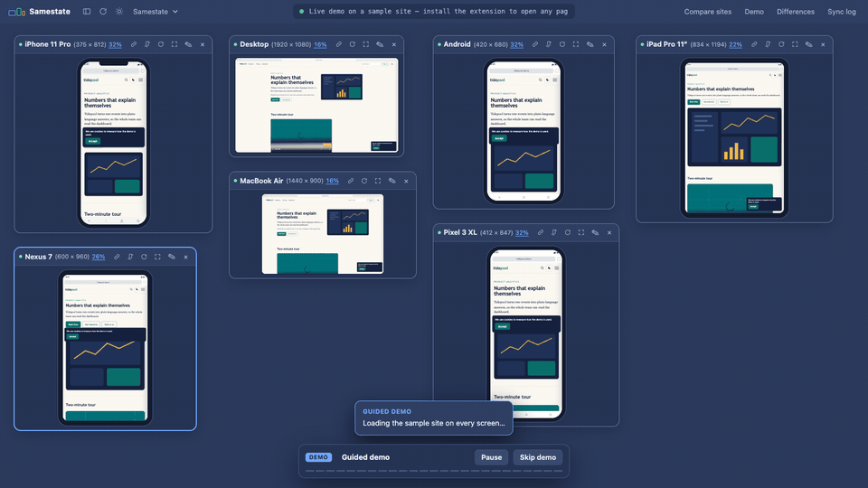
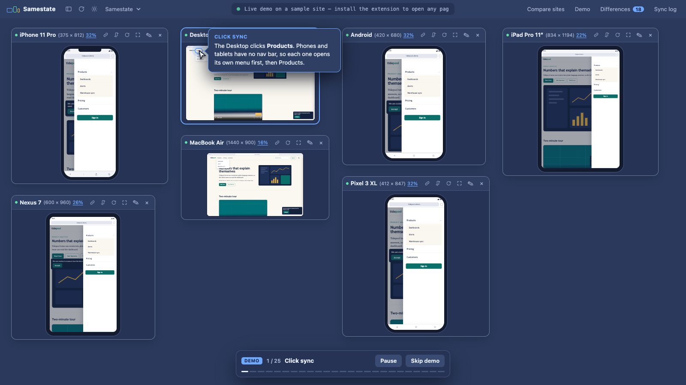
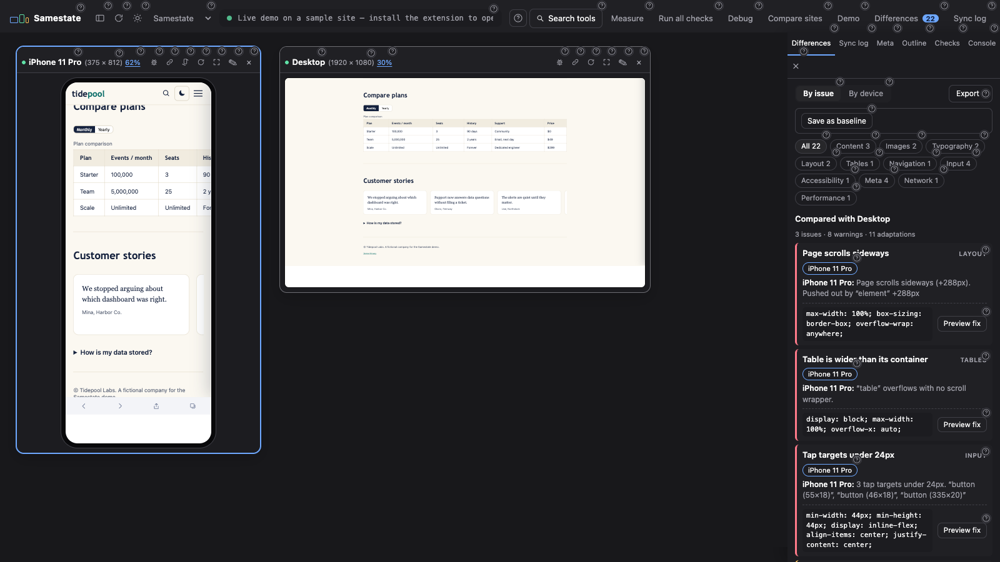
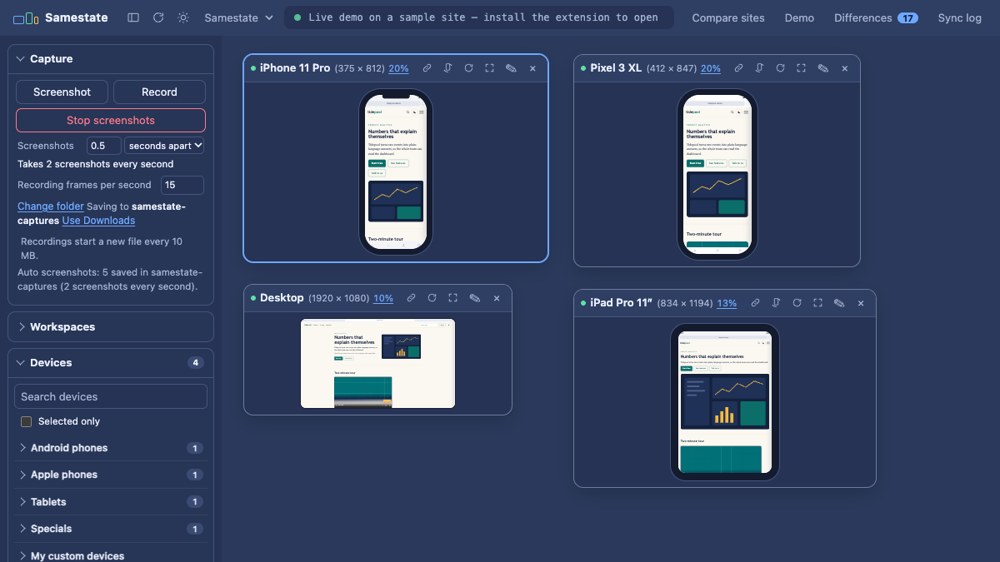

<p align="center"></p>

<h1 align="center">Samestate</h1>
<p align="center"><b>Test your site on every screen size at once, and see what breaks.</b><br>
Click once on any device. Every phone, tablet and desktop follows to the same state, even when the layouts are completely different.</p>

<p align="center">·
  <a href="docs/media/samestate-promo.mp4">Watch the 30s video</a> ·
  <a href="https://chromewebstore.google.com/detail/samestate/fclklobjcdojompoloogenjhgijlkpha"><b>Add to Chrome</b></a> ·
  <a href="#how-it-works">How it works</a> ·
  <a href="#release-notes">Release notes</a>
</p>

<p align="center">
  
  <a href="https://chromewebstore.google.com/detail/samestate/fclklobjcdojompoloogenjhgijlkpha"></a>
  
  
</p>

<p align="center"><a href="https://shouvik12.github.io/samestate/"></a></p>

## Why Samestate

Responsive testing usually means resizing one window, or clicking through the same flow again on every device.
Samestate puts every screen size side by side and keeps them in the **same logical state**. A desktop
**Products** click opens the phone's hamburger menu first, then Products. Then it measures every device
against the desktop and tells you what broke: sideways scroll, tables wider than the screen, tap targets
that are too small, text that disappears.

**One interaction, every device. Then a report of what's different.**

### Highlights

| | |
|---|---|
| 🔁 **Logical sync** | Clicks, links, scrolls, dialogs and toggles carry over, even across different markup. Dark mode on a phone flips every desktop. |
| 🔍 **Difference report** | Layout, navigation, content, images, typography, tables, input, usability, accessibility (contrast, alt text, names, headings), page weight and Web Vitals, per device. |
| 📏 **Width sweep** | Resizes a screen from 320 to 1920px and reports the exact widths where each problem starts and stops. |
| 🛠️ **Fix previews** | Try the suggested CSS fix on every affected screen, check again, undo. Save a baseline to see what is new and what is fixed. |
| 🔎 **Search tools** | One searchable catalog of tools, panels, settings, debug actions, simulators and exports, with descriptions, aliases, categories and availability hints. Open from the toolbar or ⌘K / Ctrl+K. |
| 📐 **Outline & measurements** | Inspect headings, landmarks and keyboard focus order; draw overlays, pick an element for CSS measurements, and review linked best-practice suggestions. |
| ✅ **Run all checks** | Choose report groups, a saved or AI test journey, screen-setting scans and a width sweep. Follow live progress, record visual reviews and export one combined HTML or JSON report. |
| 🧪 **Test runs** | Write a test plan; an AI (OpenRouter or any OpenAI-compatible service, with your key) turns it into steps on one screen while every screen follows. Save the test and replay it without the AI, in Chrome or in CI. |
| 🤖 **CI** | `node tools/samestate-ci.mjs <url>` writes the report from headless Chrome and fails the build on new issues. |
| 🧭 **Page steps** | Walk a user journey: each link or dialog opens as a new step beside the last. |
| 🆚 **Compare sites** | Two or more sites on side-by-side device walls with linked scrolling. |
| 🎨 **Themes** | Try a tweakcn preset or your own CSS on every preview at once. |
| ✏️ **Annotations** | Draw, arrow and note on any preview; marks appear in captures. |
| 🐞 **Debug tools and simulators** | 26 debug tools (rulers, grids, Peek, measuring, readability…), 20 simulators and form autofill, for one screen or every screen. |
| 🧾 **Meta and console** | Social card previews and meta checks; console messages and errors from every screen in one list. |
| 📐 **Breakpoints** | One screen per CSS breakpoint, read from the site's own stylesheets. |
| ⌨️ **Command bar** | ⌘K / Ctrl+K for every action; Find elements by CSS selector across screens. |
| 🎬 **Capture** | Save the wall as a PNG or a WebM recording. |
| 📱 **83 devices** | Phones, tablets, foldables, watches, TVs, plus your own custom sizes. |

## Screenshots

| Logical sync | Difference report |
|---|---|
|  |  |
| Desktop clicks **Products**. Each phone opens its own drawer, then Products. | Every device measured against the Desktop, grouped by category. |

## What it does

Samestate opens a site in a wall of responsive previews for phones, tablets, laptops, and desktops.

- **Device presets.** Choose from 83 built-in viewports or save a custom size.
- **Click and scroll sync.** Samestate matches controls and scroll sections by their position in the page structure.
  A link that the page turns into a button (it opens a menu, tab or dialog instead of a page, like Google's apps
  button) is mirrored like a button.
  Enable **Match visible text** to help match controls and compare content when layouts use different markup.
  The bundled demo also maps the desktop Products menu to the phone’s navigation drawer.
- **Link sync.** Following a link on one screen opens the same page on every linked screen, including
  same-page links (`#section`) and page changes in single-page apps. Turn it off with **Links & pages** in the
  **Sync** drawer. Form submissions, downloads, links to other sites and back/forward stay on the screen you used.
- **Video playback.** Play or pause the main video across the wall from the **Sync** drawer.
- **Difference report.** Every device is measured against a reference device. **By issue** lists each problem
  once with the screens it affects; click it to outline the elements on all of them, or click a screen to see
  its details. **By device** lists every screen's findings separately.
- **Width sweep.** **Compare → Sweep widths** resizes the reference screen from 320 to 1920px, checks it every 10px
  (every 20px above 1000px) and narrows every change down to the pixel: "Page scrolls sideways at 320–660px". Findings appear under
  **Widths**. Press the button again to stop.
- **Journey report.** With **Page steps** on, **Check journey on every device** measures each step at the size of every
  selected device and compares it with the same step on the desktop, so the report says which step breaks on which screens.
- **Fix previews.** Findings with a CSS fix (wide tables, cut-off text, small tap targets, small text, sideways
  scrolling) show the CSS and a **Preview fix** button that applies it to every affected screen. **Check again**
  re-runs the report; **Undo** takes it off. Other findings show what to change in the site.
- **Baseline.** **Save as baseline** in the Differences panel keeps this scan for the site. Later scans mark new
  findings, list the fixed ones and can show **new** only.
- **Long text.** **Compare → Long text (+35%)** makes every preview's text about a third longer, with accented
  letters, as translations often do. Run **Detect differences** to see what gets cut off or pushes the layout.
- **Screen settings.** **Views → Screen settings** gives every second screen dark mode, 200% text, landscape,
  reduced motion, more contrast, print, forced-colors, reduced data, reduced transparency or wide-color styles, right-to-left
  direction or another page language, or shows it as someone with protanopia, deuteranopia, tritanopia,
  no color vision or blurred vision would see it.
  With **Same device on every screen**, that shows one device both ways side by side.
- **Check links.** With **Compare → Check links** on, **Detect differences** also asks the site for each same-origin
  link on every screen and reports the ones that answer 404, 410 or a server error.
- **Sync log.** Shows which devices matched, skipped, or could not reach a control.
- **Screenshots and recordings.** Save the visible device wall as a PNG or a silent WebM video.

### What the report catches

| Category | Examples |
|---|---|
| Layout | Page scrolls sideways, side-by-side blocks that stack, text touching the screen edge, key controls and the main heading pushed below the fold |
| Navigation | Nav collapses behind a menu button, or items that vanish with no way to reach them |
| Content | Text and controls hidden on smaller screens, cut-off text |
| Images | Changed shape, stretched or broken images |
| Typography | Type scale changes, text under 12px, lines over 80 characters |
| Tables | Tables wider than the screen, tables that need a sideways swipe |
| Input | Tap targets under 24px and 40px |
| Usability | Overlays that sit on top of buttons (cookie banners), missing viewport tag, unknown autocomplete values |
| Accessibility | Text below WCAG contrast, images without alt text, controls without a name, no main heading, heading levels that skip, no page language, pinch zoom turned off, missing or repeated landmarks, unlabelled navigation, vague link text (“click here”), the same link text for different pages, fields labelled only by a placeholder, positive tabindex, controls the Tab key reaches inside closed menus and panels, Tab order that jumps around the screen |
| Performance | Web Vitals per screen: layout shifts (CLS) and slow interactions (INP) flagged, largest paint (LCP) shown |
| Widths | From **Sweep widths**: the widths where each problem appears, including WCAG 1.4.10 Reflow at 320px |
| Navigation links | With **Check links**: same-origin links that answer 404, 410 or a server error |
| Errors | JavaScript errors and files that failed to load, per screen (details in the **Console** panel) |
| Meta | Title and description length, missing social card tags, relative og:image, canonical URL, favicon, noindex, charset, duplicate meta tags, invalid structured data (once, for the reference screen) |
| Network | Page weight per screen, phones downloading as much as the desktop, hidden images that still download, images much larger than shown, API responses over 100 KB |

## Install

Samestate is a Chrome extension. No server and no terminal.

### From the Chrome Web Store (recommended)

1. Open **[Samestate on the Chrome Web Store](https://chromewebstore.google.com/detail/samestate/fclklobjcdojompoloogenjhgijlkpha)**.
2. Click **Add to Chrome**, then **Add extension**.
3. Pin the Samestate icon from the puzzle-piece menu.

Works in Chrome and other Chromium browsers (Edge, Brave, Arc) on desktop. Updates install automatically.

### From source

1. Download this repo (**Code → Download ZIP**) and unzip it.
2. Open `chrome://extensions`.
3. Turn on **Developer mode** (top right).
4. Click **Load unpacked** and choose the `extension` folder **inside** the unzipped repo
   (the one that contains `manifest.json`), not the repo's top-level folder.
5. Pin the Samestate icon from the puzzle-piece menu.

Click the Samestate icon on any page to open that page on every screen, in a new tab beside it. Previews share
your Chrome sign-ins, so a page you are signed in to stays signed in (turn off **Use my sign-ins** to preview signed
out). The first time you open a site, press Enter and grant Chrome access to it. Clicked anywhere else, the icon
opens Samestate on the bundled sample site; to preview another site, enter its address. The **Demo** button plays a guided demo on a
sample site with 46 guided stops. Alongside sync, annotations, layout, Page steps and Compare sites, it now shows
fix previews and baselines, accessibility and page-weight reports, width sweeps, screen settings, breakpoints,
debug tools and simulators, grids and design overlays, forms and typing sync, tool search, Meta and Console,
outline and measurements, saved test replay, optional AI setup, grouped checks with human reviews, capture formats
and workspace sharing. It demonstrates Clean Green and the Zinc night palette too.

Use **Previous / Next**, the **step picker**, or **Left / Right arrows** while focused in the demo controls to move through the walkthrough. You can also swipe across the demo bar. Manual navigation holds the selected step; **Resume** returns to automatic playback. Backward moves and jumps prepare the scene for the selected step.

All 46 stops have bundled **natural AI voice narration**. **Mute / Unmute** sits beside **Pause** and remembers your choice. Pause and Resume control the narrator too; step navigation stops the previous clip, and autoplay waits for the current explanation to finish. If the browser initially blocks sound, click **Enable voice** in the same position. Playback needs no API key or voice-service connection.

**Voiced tooltips work throughout the app.** Hover or focus a button, setting, section heading or preview tool to read its explanation, then choose **Hear explanation** to listen. Press **F1** to focus the help controls and **Esc** to dismiss them; touch users can long-press a control. The same help covers dialogs, debug tools, search results, reports, review actions and measurements. Speech starts on demand, and pauses a running demo until the explanation finishes. Field values, API keys, notes and preview-page content are not used to generate the voice explanations.

A pointer performs the actions and explains the real results. The test journey and Clean Green palette are bundled,
so those demonstrations need no AI account or theme download. Visual reviews stay pending for the tester;
capture and file-sharing controls are shown without starting downloads or recording. Skip stops demo-owned checks
and restores temporary tests, baselines, check selections, overlays and settings.

## Choose devices and options

Pick the interface theme from the menu next to the reload button: **Samestate** (Zinc in dark mode), **Neutral**,
**Clay**, **Teal**, **Hive** or **Clean Green**. The sun and moon button beside it switches any theme between day and night mode.
Clean Green uses the supplied tweakcn light/dark palette, rounded controls, soft shadows, locally bundled Inter and
JetBrains Mono, and a Georgia serif fallback. Your interface theme and mode are saved in this browser.
They change Samestate's own colors, not the previews; to try colors on your site, see
[Preview a color theme](#preview-a-color-theme).

Open **Devices** to browse Android phones, Apple phones, tablets, and specials such as foldables, watches, and TVs. Search by model or dimensions, or turn on **Selected only** to edit the current wall. Under **My custom devices**, enter a name, width, height, and frame type to save a preset in this browser.

Click **×** in a preview’s title bar to close it. Select the device again in **Devices** to reopen it.

**Capture**, **Views**, **Layout**, **Sync**, and **Compare** each open and close independently. Use the toolbar’s sidebar button to hide or reopen the panel.

Dimensions are CSS viewport presets for testing layouts in Chrome. The catalog uses the [Mobile FIRST viewport reference](https://www.webmobilefirst.com/en/devices/) and [Apple’s display guidance](https://developer.apple.com/cn/design/human-interface-guidelines/layout), including the [iPhone 18 Pro specifications](https://www.apple.com/iphone-18-pro/specs/).

## Compare devices and page steps

- **Views → Phone and tablet identity** (off by default) makes phone and tablet previews tell the page's scripts what they are: an iPhone or Android user-agent and platform, touch support, a 3× (phones) or 2× (tablets) pixel ratio, the device's screen size, and touch answers to `matchMedia()` hover and pointer queries. iPads report themselves as a Mac with touch, as real iPads do. Desktop presets keep your browser's own identity. In the extension, page loads in those previews also reach the server with the device's user-agent, so sites that choose the layout on the server (Google, for example) send their phone or tablet pages. Previews reload when you change it. It is off by default so that every screen starts from the same page and clicks have something to match.
- In **Views → Device sizes**, choose **Different devices** to use the selected presets or **Same device on every screen** to give those previews one shared size. Select **Device for all previews** to resize them in place.
- Turn on **Views → Page steps** to start a row with the page you originally opened. Follow a same-origin link or use a supported control, such as **Sign in**, to open the next state beside the current screen. Dialogs, menus and tabs can become steps even when the address stays the same. In the extension, you can also enter a path such as `/pricing` in the address bar. Close a step with **×** in its header.
- To switch sites, enter a domain or full URL in the address bar. After Chrome grants access, the new site opens at Step 1 with the selected device size.
- To see the same steps at laptop size, select a preset such as **MacBook Air** under **Device for all previews**. Turn **Page steps** off to return to the device wall. Your open previews are kept when you switch between the two views.
- Drag a preview by its title bar to place it anywhere on the wall. In **Layout**, use **Lock layout** to keep previews in place or choose **Row** or **Grid** to restore automatic placement. Each view keeps its own arrangement.

When previews extend beyond the visible wall, drag the scrollbar at the bottom to move left or right. The bar is available with the sidebar closed.

Click the percentage in a preview’s title bar to change its display scale. Choose **100% (CSS px)** to display the page at its viewport dimensions, enter a custom percentage, or choose **Auto** to follow the wall zoom or Focus fit again. The dimensions apply to the webpage area inside the frame. Its physical size depends on the display and system scaling.

To match a device on your monitor, open the preview’s percentage menu and expand **Physical size**. Measure the blue line with a ruler, enter its length in millimetres, then choose **Match size**. The iPhone 11 Pro uses its published screen and body dimensions. For other presets, enter the width of the device’s lit display. Measure the line again after changing monitors, Chrome zoom, or system display scaling. [iPhone 11 Pro specifications](https://support.apple.com/en-us/111879)

## Compare websites side by side

Click **Compare sites** in the toolbar. Two device walls open side by side, with the current site loaded on every device in both walls. Enter a different address in either column to update all of its devices. Use **+ Add site** for more walls. The **Viewport** menu defaults to **All devices**, with options for one responsive or fixed-size preview.

Click **Compare sites** again to return to the device wall. The open site columns, devices, and page steps stay loaded when you switch. Chrome asks for access when you open a new site. The hosted demo starts both walls on its bundled home page.

Scroll outside the webpages to move the site walls up or down together. Use the sidebar to select devices, change the layout, or capture the visible comparison. Sync and difference reports work within each site's device previews. The **Page steps** control opens the journey view on the device wall.

## Annotate previews

Click the pencil in a preview’s title bar. Choose **Draw**, **Line**, or **Arrow**, then drag over the page. Choose **Note**, click where it belongs, and save your text. Click a note while the Note tool is active to edit it. Use **Erase** to remove a mark or note.

Click the pencil again to interact with the webpage while keeping the marks visible. Annotations belong to the individual preview in the current tab, including in **Page steps** and **Compare sites**. They follow the preview when it moves or resizes and appear in wall captures.

## Preview a color theme

Open **Theme** in the sidebar. Under **Apply to**, choose a preview, a **Compare sites** column, or all visible previews. Pick a **tweakcn preset** by name to load and apply it automatically. Use **Light**, **Dark**, or **Follow site** to switch palettes.

Sites that use shadcn color and radius variables can pick up the theme directly. **Recolor basic elements** also changes the page background, text, links, buttons, and input borders on sites with hard-coded styles. In **Compare sites**, apply the theme to one column to see it beside the original.

**Clean Green** is also a built-in preview preset, available without downloading its palette. Preview presets apply colors and radius; the interface fonts stay in Samestate's own UI.

For your own design, choose **Custom CSS…**, paste the CSS export, and click **Apply theme**. Themes use supported color and radius values and stay in the current Samestate tab. Click **Reset** to restore the selected previews. [tweakcn editor](https://tweakcn.com/editor/theme)

## Debug tools and simulators

Click the bug button in a preview's title bar to open its **Debug** menu, or **Debug** in the top bar for every
visible screen. Tools can be combined; each screen has one simulator at a time. The bug button shows how many are on.
In the top-bar menu, a dash means some screens have it and others don't; choosing it turns it on for all of them.
Screens you open later start with what the top-bar menu set.

**Debug tools**

| Group | Tools |
|---|---|
| Layout | **Layout debugging** (outlines every element, marks the ones that stick out past the right edge), **Show z-index**, **Reachability** for the right or left thumb |
| Accessibility | **Contrast checker** (ratio on text below WCAG AA), **Track focus** (role and name of the focused element), **Target size** (under 24px and 44px), **Small text** (under 12px, fields under 16px), **Text spacing** (WCAG 1.4.12), **Show roles**, **Show ARIA attributes**, **Apply all hover styles**, **Apply all focus-visible styles** |
| Content | **Edit content**, **Hostile CSS** (ugly defaults that well-isolated components ignore), **Audible changes** (a beep, in each screen's own pitch, when the page changes) |
| Disable | **Disable CSS**, **Disable images**, **Hide cursor** |

**Simulators**: protanomaly, protanopia, deuteranomaly, deuteranopia, tritanomaly, tritanopia, achromatomaly,
achromatopsia, cataracts, glaucoma, farsightedness, astigmatism (horizontal or vertical), tunnel vision, macular
degeneration, CMV retinitis, photophobia, bright sunshine, dimmed screen and night mode. Glaucoma, tunnel vision and
macular degeneration follow the mouse. Hover the **i** next to any item for what it does.

The marks and overlays are drawn inside the preview, so they appear in screenshots and recordings, and the
difference report ignores them. Tools that change the page (Text spacing, Disable CSS, Hostile CSS) do change what
**Detect differences** measures, so you can check what breaks.

## Meta, social previews and console

The right-hand panel has two more tabs. **Meta** shows the reference screen's title, description, canonical URL,
language, robots, theme color, manifest and structured data, the meta checks, and previews of a shared link on Google,
X, Facebook, LinkedIn, Slack, Discord and WhatsApp in light or dark. **Console** lists console messages and errors from
every screen once each, with the screens that sent them; filter by errors, warnings or logs.

## Breakpoints, find and the command bar

- **Views → Breakpoints** reads the width breakpoints from the site's stylesheets (min-width, max-width and range syntax, in
  px, em or rem). **Open one screen per breakpoint** replaces the wall with one screen at each width (plus 320px below the
  first), optionally with the width just below each one; **Back to my devices** restores your selection.
- **Find elements** (in the sidebar, or ⌘⇧F / Ctrl+Shift+F) highlights the elements matching a CSS selector on every screen,
  says how many each screen has, and steps through them.
- **Command bar** (⌘K / Ctrl+K): type to run any action: debug tools and simulators for every screen, Screen settings,
  capture, panels, drawers, live reload and more.

## Forms and live reload

- **Debug → Actions** fills every visible form field with valid test data or with edge cases (invalid email, accented and
  non-Latin names, very long text, HTML), or clears them. Nothing is submitted.
- **Sync → Typing & form fields** (off by default) mirrors what you type, select and check to the same field on the
  other screens. Password and file fields and `data-samestate-private` are never mirrored.
- **Sync → Live reload** reloads every screen every 5 seconds to a minute, or, for sites on this computer or network,
  **when the site changes**: Samestate checks the page, its stylesheets and scripts every 1.5 seconds; a CSS change is
  swapped in place, anything else reloads every screen.

## Design overlay, rulers and grids

- **Debug → Design overlay…** puts an exported design over one screen: exported at 1×, 2× or 3×, opacity, normal,
  difference or invert blending, a split slider and X/Y offsets. It scrolls with the page and survives reloads.
- **Rulers and guides**, **Column grid**, **Baseline grid** (set in **Grid settings…**), **Measure area**, **Peek**
  (hold Alt), **Readability** and **Measure text** are in the Debug menu with the other tools.

## Capture the device wall

With a preview open in desktop Chrome, click **Screenshot**, **Record** or **Auto screenshots**, then share the current Samestate tab in Chrome’s picker. **Screenshot** saves one PNG. **Record** starts a silent WebM video, and **Stop** saves it. You can take screenshots while recording.

- **Auto screenshots** saves a PNG of the device wall again and again until you press **Stop screenshots**. Set the pace under **Screenshots** as **per second** (0.1 to 10) or **seconds apart** (0.1 to 3600, so 5 is one every 5 seconds); switching between them keeps the same pace. The line below says what that means, such as "Takes 1 screenshot every 5 seconds" or "Takes 2 screenshots every second". The files are numbered in one series: `samestate-<time>-shot-0001.png`, `-0002.png`…
- **Recording frames per second** (1 to 60, default 30) sets the video's frame rate. Lower rates also lower the bitrate, so files are smaller.
- A recording starts a new file every 10 MB, with no pause: `samestate-<time>-part-01.webm`, `part-02.webm`… Each part plays on its own.
- **Save to folder…** picks a folder, and every screenshot and recording part is written there as it is made. Chrome remembers the folder and asks again for permission after a restart; **Use Downloads** goes back to downloads. Without a folder, each file starts a download.
- The pace, its unit and the frame rate are remembered in this browser.

<p align="center"></p>

Capture follows the visible part of the wall as you scroll or zoom. In **Compare sites**, the crop includes the visible site columns together. Samestate saves the files locally.

## Export the difference report

After **Detect differences**, open **Export** in the Differences panel and choose a format. Every finding is exported, whichever category filter is selected.

- **Markdown** for pasting into an issue or a pull request, with each problem once and a line per affected screen.
- **CSV** with one row per finding and screen, for spreadsheets and bug trackers.
- **HTML page**, a single file that opens in any browser.
- **HTML with screenshots** adds a cropped screenshot of the affected screen to each finding, with the elements outlined. Share the current Samestate tab when Chrome asks. Samestate shows each screen on its own in Focus mode while it takes the screenshots, then returns to your layout. This option is on the device wall only, not in **Compare sites**.

## Run it in CI

`tools/samestate-ci.mjs` loads the extension in headless Chrome, opens a site on the device wall, runs the
difference report and writes `report.md`, `report.html`, `report.csv` and `report.json`. It needs Node 22 or later
and Chrome, and no packages.

```
node tools/samestate-ci.mjs https://preview.example.com --devices=iphone,pixel,ipad,desktop --sweep
```

- `--fail-on=issue` (default), `warn` or `none` sets when it exits with code 1. A screen that does not answer in time
  also fails the run (unless `none`), and is listed as `notMeasured` in `report.json`.
- `--baseline=old/report.json` compares with an earlier run, so new findings and newly affected elements can fail the build.
  Older reports with no element keys compare counts for grouped findings.
- `--identity` turns on phone and tablet identity, including the server user-agent.
- `--links` also checks same-origin links and reports broken ones.
- The report also includes the Meta, Errors, landmark, link-text and line-length checks.
- `--devices` takes ids from `extension/devices.js`; `--reference` picks the screen the others are compared with.
- `--test=test.json` runs a saved test file on every screen before the report and writes `test-results.json`.
  A step that fails on any screen fails the run (unless `--fail-on=none`). With `--test`, the url can be left out: the
  test's own site is used. The AI is never called in CI.

In GitHub Actions, run it after the preview deploy and attach the folder as an artifact:

```yaml
- uses: actions/setup-node@v4
  with: { node-version: 22 }
- run: CHROME_PATH="$(command -v google-chrome)" node tools/samestate-ci.mjs "$PREVIEW_URL" --out=samestate-report
- uses: actions/upload-artifact@v4
  if: always()
  with: { name: samestate-report, path: samestate-report }
```

## Search every tool and feature

Press **Search tools** in the toolbar, or **⌘K / Ctrl+K**, to open one lookup for Samestate's features. Search by name or purpose: try **metadata**, **spacing**, **recording**, **best practices**, **PDF**, **OpenRouter**, or **where can I find meta data**. Minor spelling mistakes are tolerated, and exact tool names rank first.

Every result has a description and category. Filter by category, browse the full catalog with an empty search, or use the arrow keys and **Enter** to open or run a result. **Escape** closes the lookup and returns focus. All matches remain available in the scrollable list; the old 60-result cap is removed.

The catalog includes the current sidebar/panel controls, all debug tools and simulators, reference-screen design overlays, Outline/measurements, Run all checks, Meta/social previews, form tools, sync settings, theme choices, captures/formats, workspace actions, test/AI setup, report exports and baselines. It is rebuilt from the current UI so its availability stays current. Disabled or context-dependent features remain discoverable with a reason; choosing one explains its requirement and performs no action. Existing capture permissions, test confirmations and AI settings continue to apply. Searching itself makes no AI request and does not read API-key or text-field values.

## Outline, measurements and suggestions

Press **Measure** in the top bar, or open the **Outline** tab in the right panel. Choose a screen and use **Refresh** after the page changes.

- **Headings** shows native and ARIA headings, their levels, hidden states and structure suggestions. **Landmarks** shows page regions and their names. **Keyboard focus order** lists estimated Tab stops, including positive tabindex, off-screen skip links and the selected radio option; disabled, inert and closed-details content is excluded.
- Turn on **Headings**, **Landmarks** or **Focus order** overlays to see structure, region boxes, and numbered stops connected by arrows on that screen. **Clear** removes inspection overlays from every preview. The overlays are isolated from the page's CSS and excluded from reports.
- Choose an outline item or press **Pick element** and click inside the selected preview. Picking measures the element without activating its control or mirroring the click. Press **Escape**, **Cancel pick**, or leave the Outline tab to end picking.
- The measurements include CSS width/height, page coordinates, margin/padding/border, viewport-edge distances, display/gap, font size/line height/weight, colors, estimated line length and contrast when measurable. They are before preview scaling and visual simulation filters.
- Suggestions link to W3C guidance and distinguish checks, recommendations and human-review cases. For example, small target guidance includes the WCAG spacing and inline exceptions; the 44px AAA touch target goal is distinguished from the 24px AA minimum. Reading-line and line-spacing advice is labelled as guidance rather than an automatic conformance verdict.
- **Suggestions only** filters the outline. **Export JSON** saves the outline, selected measurements and guidance locally. Input values and content marked `data-samestate-private` are not included. The **Run all checks** visual group also includes an Outline/measurement review task.

The outline is derived from the DOM, not the browser's full accessibility tree. Nested frames and shadow roots are not traversed; test actual Tab/Shift+Tab, screen-reader behaviour, custom widgets and modal focus. Contrast is unavailable on hidden content, opacity, image/gradient backgrounds and some composite text. A clean inspector is not a complete accessibility assessment.

Guidance references: [headings](https://www.w3.org/WAI/tutorials/page-structure/headings/), [page regions](https://www.w3.org/WAI/tutorials/page-structure/regions/), [focus order](https://www.w3.org/WAI/WCAG22/Understanding/focus-order.html), [contrast](https://www.w3.org/WAI/WCAG22/Understanding/contrast-minimum.html), and [target size](https://www.w3.org/WAI/WCAG22/Understanding/target-size-minimum.html).

## Run all checks from the UI

Press **Run all checks** in the top bar. Select the groups in the sidebar, then press **Run selected checks**:

- **Layout & content**, **Accessibility & usability**, **Meta & page errors**, **Performance & page weight**, and optional **Broken links** share one scan across the current device wall.
- **Test journey** runs the saved test without AI, or follows the plan with the OpenRouter / OpenAI-compatible connection configured in **Test runs**. Use **Set up test / AI connection…** to write the plan, open a test file or configure the service. The selected journey runs before the report groups, which scan its final page state; add layout-check steps to the journey to measure earlier states. AI writing runs first so Chrome can request service access from the Run button. It sends the same page text and control names as **Write test with AI**; credentials are never included in combined exports.
- **Screen settings & long text** scans each non-vision setting in turn and then longer text. Select at least two devices for the alternating-screen settings. **Responsive width sweep** samples the reference screen between 320 and 1920px. These scans can take a few minutes.
- **Visual tools & interactions**, **Capture & file output**, and **Workspace portability** create specific human-review tasks covering panels, breakpoints, debug tools, simulators, overlays, search, forms, synchronization, live reload, capture formats and saved workspaces. **Open tools** takes you to the relevant controls. Record **Pass**, **Fail** or **Skip**, and optional notes; unreviewed tasks stay **Needs human review**.

The **Checks** tab combines findings, journey step results and human decisions. Missing previews, unmeasured Web Vitals and incomplete scans stay visible; a successful journey does not approve the visual tasks. Layout checks inside a journey retain their issue/warning counts. **Stop** ends the run after the current measurement and marks unfinished checks; temporary screen settings, rotation, long text, link-check selection and live reload are restored. Other preview controls are locked only while automated checks run.

Use **Export HTML** or **Export JSON** for a combined report, including notes and pending reviews. Results remain in the current tab until a new run or reload, so export before leaving. This workflow runs from the UI and requires no CI setup. It does not automatically judge visual correctness or exercise every Samestate control: those items explicitly require a tester's decision.

## Test runs

Open **Test runs** in the sidebar. A test is a list of steps that runs on every linked screen at once, and passes
when every step works on every screen.

- **Write test with AI.** Describe what to do and what should happen in **Test plan** ("Sign up with
  test@example.com and check the thank-you message, then open About"). Under **AI connection**, keep **OpenRouter**
  or pick **Other (OpenAI-compatible)** for another service, such as Ollama on your computer
  (`http://localhost:11434/v1`). Enter the model (default `anthropic/claude-sonnet-5.5`) and your API key, then
  press **Write test with AI**. Chrome asks once for access to the service. The AI drives the screen chosen in
  **Compare → Compare to**, one step at a time, and each step also runs on the other screens. It adds checks for the
  outcomes in your plan, and can run the difference report at a step. Press **Stop** at any time.
- **Record clicks.** Your clicks on buttons and menus, and the pages you open, become steps.
- **Add check.** Adds a step that passes on a screen when the text you enter is visible on it.
- **Run test.** Opens the start page on every screen, runs every step and shows, per step, on how many screens
  it worked (hover for each screen). A step that found no control on a screen names the screen.
- **Save test file** and **Open test file…** keep tests as JSON. A saved test runs without the AI, so it takes the
  same steps every time.

Steps find each control by its role and visible name (button "Sign in"), so the same step works across layouts.
On a screen where a navigation item sits behind a menu button, the step opens the menu first.

Safety:
- With **Use my sign-ins** on, Samestate asks before a test runs: every step acts on your real account, on each screen.
- Before the AI clicks something like Delete, Buy, Pay or Unsubscribe, Samestate asks you.
- The AI can only open pages on the site you opened. Page text is passed to it as untrusted content.
- Only the reference screen's address, visible text and control names go to the AI service, and only while it
  writes. Field values and `data-samestate-private` text never do. Your key stays in the extension's storage for the
  browser session (or on this computer with **Remember the key**) and is never written to a test file.

Writing with AI needs the extension. The web demo can open, record and run tests.

## Save and reopen a setup

Open **Workspaces** in the sidebar, enter a name, and click **Save**. A workspace keeps the site, the selected devices and their rotation, scale and link state, the layout (mode, zoom, alignment, lock and dragged positions), **Views** settings and page steps, **Compare sites** columns, sync settings, themes and annotations. Click **Open** to return to it; Chrome asks once for any sites that need access. Saving under an existing name replaces it.

The setup in use when the Samestate tab closes is kept as **Last session**. Workspaces are stored in this browser only. Dragged positions in comparison columns are not saved.

## Sync video playback

Open the video’s page directly in Samestate, then open **Sync** and click **Play all** or **Pause all**. With **Video playback** checked, playing or pausing in one linked preview also updates the other linked previews.

If Chrome blocks playback with sound, Samestate tries again muted. The Sync log shows the result for each preview. Players embedded from a different site need to be opened on their own page for Samestate to control them.

## Chrome extension privacy

Samestate uses element structure, visibility, and layout measurements to produce its reports. **Match visible text**
is off when you open a preview. When enabled, the preview reads rendered text locally and uses temporary
fingerprints for comparison. Raw page text stays out of the report and sync log. Visible text can contain
personal data. Mark elements with `data-samestate-private` to exclude their text from matching.

The **Network** findings use the browser's resource timing: each request's address, type and size. Query strings
are dropped, path segments that look like IDs show as `:id`, and request and response contents are never read.

Form fields, editable regions, page titles, cookies, and site storage are excluded from the difference report. Form
input and submissions stay in the preview where you use them, unless you turn on **Sync → Typing & form fields**, which
copies typed values (never passwords or file fields) to the other previews in the same tab. The **Meta** panel reads the
page's title and meta tags, and the **Console** panel its console messages and errors; both are shown only in
Samestate, and the report carries only lengths, counts and tag names. **Live reload** set to *when the site changes*
fetches the page, its stylesheets and scripts from your local site to compare them; nothing is sent elsewhere. **Page steps** uses the destination of a same-origin link
or the structure of a supported control to open the next preview. Samestate scopes inspection to the device wall’s site.
**Write test with AI** sends the reference screen's address, visible text and control names (never field values) to
the AI service you set up, only while it writes a test; see [Test runs](#test-runs).
**Check links** (off by default) sends a HEAD request without cookies to each same-origin link on the page, at most 60
per screen, and skips links whose path looks like an action (sign out, delete, unsubscribe, cancel). Only the status code is kept.
**Compare sites** applies the same inspection rules to each opened site and mirrors interactions only within that site’s column. Previews use your Chrome cookies and site storage for the site, so a page you are signed in to opens signed in on every screen. Turn off **Use my sign-ins** under **Views** to start each preview signed out, with separate, temporary storage.

## How it works

```
extension/
  background.js   Lets opened origins load inside a Samestate tab and connects the device wall agent.
  agent.js        Measures layout and mirrors interactions using element positions and control types.
  app.html/js/css The device wall, site comparison, message router, sync log, and difference engine.
  devices.js      Device presets, search, and custom device settings.
  annotations.js  Notes, strokes, lines, and arrows on individual previews.
  themes.js       Loads tweakcn presets, parses custom CSS, and builds preview styles.
  emulate.js      Gives phone and tablet previews their device identity before the page's scripts run.
  capture.js      Local screenshots and recordings of the device wall.
  report.js       Exports the difference report as Markdown, CSV or HTML.
  workspaces.js   Saves and reopens setups in the browser's local storage.
  testrun.js      Test runs: recording, test files, running steps on every screen, and writing tests with AI.
  demo/           The sample site used by the guided demo.
docs/             The same app as a static page for the live demo (GitHub Pages).
tests/smoke.mjs   Plays the guided demo in headless Chrome and checks each step.
tests/testrun.mjs Writes a test with a stand-in AI service in the extension, replays it, and runs it in CI.
tools/samestate-ci.mjs  Runs the difference report on any site in headless Chrome, for CI.
```

Run the smoke test with Node 22 or later and Chrome installed: `node tests/smoke.mjs`. It needs no packages, plays all 46 demo steps, and runs on every push and pull request to `main`. `node tests/tool-search.mjs` checks the lookup, ranking, keyboard navigation, availability, discoverability and field-value exclusions. `node tests/outline.mjs` checks outlines, measurements, overlays, safe picking and privacy. `node tests/checks.mjs` checks the grouped UI workflow, review decisions, exports, missing measurements and cancellation. `node tests/testrun.mjs` checks test runs in the extension, with a stand-in for the AI service, and needs no key.

`node tests/tour-navigation.mjs` checks Previous/Next, direct jumps, keyboard navigation, swipes, interrupted work and saved preferences against the live demo scenes. `node tests/tour-cleanup.mjs` checks that Skip and manual tool takeover restore the tester’s previous state.

`node tests/tour-voice.mjs` decodes every narration clip and checks real playback, browser autoplay blocking, mute persistence, Pause/Resume, scene synchronization and audio-error recovery. The scene/navigation suites run muted so they can test the visual workflow at accelerated reading speed.

`node tests/feature-help.mjs` checks complete control coverage, all 473 help audio files, hover/focus/F1/Escape behaviour, modal dialogs, private-field exclusions, dynamic reports, responsive layouts and coordination with the demo narrator. Help descriptions live in `extension/feature-help-catalog.js`; Search tools uses the same descriptions. The bundled audio is generated from `tools/feature-help.json` with `tools/build-demo-narration.py --help-catalog tools/feature-help.json --model /path/to/kokoro-v1.0.onnx --voices /path/to/voices-v1.0.bin`.

## Known limits

- **Sweep widths** checks every 10px up to 1000px and every 20px above, so a problem that starts and stops between two
  checked widths (narrower than that) is not reported.
- With **Use my sign-ins** on, every screen acts on your real account: a synced click on Delete or Buy happens on
  each screen. Turn it off, or unlink screens, before testing actions like these.
- Clicks and report comparisons can miss matches when a site uses different markup and text across screen sizes.
- In a single-page app, the other screens load the new address as a full page rather than through the app's
  router, so state kept only in memory (an open filter, a typed search) is not carried over.
- The server user-agent applies to page loads in phone and tablet previews, not to their images, scripts or API
  calls, and only to pages the preview opens itself (links, link sync, Align screens, reloads). A page a script
  opens with `location.href` gets the desktop user-agent. It needs the extension; the web demo has no server.
- **Screen settings → Light and dark** rewrites the page's `prefers-color-scheme` rules in the stylesheets it can
  read. Stylesheets from other sites and scripts that ask `matchMedia()` still get your computer's setting.
- **Reduced motion**, **More contrast** and **Print** rewrite the page's media rules the same way, so scripts that ask
  `matchMedia()` still get your computer's answer. **Print** keeps the screen's width; it does not lay the page out on paper.
- Vision settings are a color filter over the preview (Machado et al. matrices at full severity), not a model of every eye.
- The contrast check skips text over images, video, gradients and background images, and reads opacity and
  `mix-blend-mode` as if they were not there.
- LCP is measured while every preview loads at once, and previews off screen paint late, so it is shown but never flagged.
  Chrome can stop drawing previews that are out of view (in headless CI, for example); their CLS then reads
  "not measured". Layout shifts that happen within 0.8 s of a Samestate action (a mirrored click, a new setting) are left out.
- A baseline compares broken links only when both scans checked links.
- **Check links** judges only same-origin links. Links that need a sign-in answer 401 or 403 without cookies and are not reported.
- Debug tools and simulators are not saved in workspaces, and turn off when the Samestate tab closes.
- **Forced-colors** only switches the page's `forced-colors` media rules; it does not repaint the page in system colors.
- The **Console** panel shows messages from when Samestate's script starts in a preview. In the web demo that is after
  the sample page's first scripts; in the extension it is from the start of the page.
- **Live reload when the site changes** fetches the page with your cookies every 1.5 seconds, so it is for sites on
  this computer or network only. If the HTML changes on every load, only stylesheets and scripts are watched.
- **Full page** scrolls one screen and stitches the screenfuls; fixed and sticky elements show only in the first one.
  Pages taller than about 32,000 pixels in the capture are cut there.
- **Typing & form fields** finds the same field by its place in the page or its name; fields with neither in common
  are not mirrored.
- Breakpoints come only from stylesheets Samestate can read, not from other sites or container queries.
- **Apply all hover/focus-visible styles** copy the rules from stylesheets Samestate can read; stylesheets from other
  sites are left out, and so are hover styles set by scripts.
- Simulators are approximations (color blindness uses the Machado et al. matrices), meant to catch clearly broken
  designs, not to show what any one person sees. Overlays are redrawn for what is on screen as you scroll.
- **Disable CSS** and **Hostile CSS** do not reach styles added after they are turned on, or inside shadow DOM.
- **Long text** lengthens the text on the page as it is; text the page adds later is not lengthened.
- **Sweep widths** keeps the screen's kind (touch or not) at every width, and **Check journey on every device**
  resizes the steps without reloading them, so pages that pick a layout when they load can differ.
- Fix previews set inline styles on the elements of one scan; a page reload removes them.
- Test steps use synthetic clicks and key presses. Pages that ignore events that are not from a real user, and
  controls inside other sites' frames, cannot be driven. Recorded clicks are matched by their place in the page, so
  they can miss on layouts with different markup; steps written by the AI or by hand use the control's name.
- A link a test step follows loads as a full page, also in single-page apps.
- CSS `hover`, `pointer` and resolution media queries in stylesheets still describe your computer; only
  `matchMedia()` in scripts answers as the device.
- Device identity is read when a page loads: after rotating a preview or changing its preset, reload it.
- Pixel ratio is 3 for phones and 2 for tablets, not each model's exact value.
- Network sizes come from resource timing. Other sites report no size unless they send `Timing-Allow-Origin`,
  so page weight undercounts third-party requests. Lazy-loaded files count only once a screen has loaded them.
- Security headers are removed inside Samestate tabs so pages can be framed. Use those tabs for
  previewing, not for sensitive browsing. Other tabs are untouched.

## Roadmap

- Fix previews for more findings (overlays, images, contrast), and fixes written as a stylesheet to copy
- Server user-agent for a preview's images, scripts and API calls, not only its page loads

## Release Notes

Each change has a file in [`changelogs/`](changelogs/) with the details. Commit times include the UTC offset recorded by Git.

| Date | Commit time | Commits | Feature / Update |
|------|-------------|---------|------------------|
| **2026-11-19** | | | **Voiced tooltips throughout the app**: 473 explanations for controls, sections, preview tools, dialogs and results, with on-demand natural voice and F1/Escape access ([details](changelogs/CHANGELOG-voiced-feature-help.md)) |
| **2026-11-19** | | | **Demo voice explainer**: natural AI narration for all 46 steps, Mute beside Pause, synchronized playback and a saved mute preference ([details](changelogs/CHANGELOG-demo-voice.md)) |
| **2026-11-19** | | | **Sidebar width fix**: wrap long labels and button text, stack breakpoint actions, and keep capture controls within their drawers at narrow widths ([details](changelogs/CHANGELOG-sidebar-width.md)) |
| **2026-11-19** | | | **Demo carousel navigation**: Previous/Next, direct step selection, keyboard arrows and swiping, with prepared scenes and Resume for autoplay ([details](changelogs/CHANGELOG-demo-carousel.md)) |
| **2026-11-19** | | | **Guided demo refresh**: 21 new stops demonstrate the past week’s missing tools, real test replay and grouped checks, pending human reviews and safe cleanup ([details](changelogs/CHANGELOG-demo-weekly-refresh.md)) |
| **2026-11-19** | | | **Samestate Zinc dark mode**: Zinc gray surfaces, neutral text and borders replace Rust, retaining the original blue accents ([details](changelogs/CHANGELOG-zinc-dark-theme.md)) |
| **2026-11-19** | | | **Samestate Rust dark mode**: Rust surfaces replace the default blue dark surfaces, retaining the original blue accents ([details](changelogs/CHANGELOG-rust-dark-theme.md)) |
| **2026-11-19** | | | **Clean Green theme**: supplied light/dark interface palette, local Inter and JetBrains Mono, rounded controls and shadows; built-in preview palette ([details](changelogs/CHANGELOG-clean-green-theme.md)) |
| **2026-11-19** | | | **Search tools**: visible unified lookup, full feature catalog, descriptions and aliases, category filters, typo-tolerant purpose search, availability hints and keyboard navigation ([details](changelogs/CHANGELOG-tool-search.md)) |
| **2026-11-19** | | | **Outline & measurements**: per-screen headings/landmarks/focus-order lists and overlays, safe element picking, CSS measurements, W3C-linked best-practice suggestions and JSON export ([details](changelogs/CHANGELOG-outline-measurements.md)) |
| **2026-11-19** | | | **Run all checks**: selectable UI check groups, saved or AI journeys, live progress and Stop, screen-setting scans, combined results, explicit human reviews with notes, and HTML/JSON export ([details](changelogs/CHANGELOG-run-all-checks.md)) |
| **2026-11-18** | | | **Preview tools**: Meta panel with social previews, Console panel, CSS breakpoint screens, forced-colors / reduced data / transparency / wide color / RTL / language settings, design overlay, rulers and guides, column and baseline grids, Measure area, Peek, readability, Measure text, Find elements, command bar (⌘K), form autofill, typing sync, live reload, full-page and overview screenshots in PNG, JPEG or PDF, workspace export and import, and report checks for meta tags, landmarks, link text, form labels, line length and errors ([details](changelogs/CHANGELOG-preview-tools.md)) |
| **2026-11-18** | | | **Debug menu**: Debug tools (layout, z-index, reachability, contrast, focus, target size, small text, text spacing, roles, ARIA, forced hover and focus styles, edit content, hostile CSS, audible changes, disable CSS or images, hide cursor) and 20 simulators, from a bug button on every screen or Debug in the top bar for all screens ([details](changelogs/CHANGELOG-debug-menu.md)) |
| **2026-11-18** | | | **Accessibility, media and Web Vitals**: Screen settings add reduced motion, more contrast, print and five vision filters; the report adds contrast, alt text, control names, headings, page language and zoom checks, a Performance category with Web Vitals, and an optional same-origin link check (`--links` in CI) ([details](changelogs/CHANGELOG-a11y-media-vitals.md)) |
| **2026-11-16** | | | **Test runs** — write a test plan and let an AI (OpenRouter or any OpenAI-compatible service, with your key) turn it into steps that run on every screen; record clicks, add text checks, save and open test files, and replay them in CI with `--test` ([details](changelogs/CHANGELOG-test-runs.md)) |
| **2026-11-16** | 15:03:23 +09:00 | `aafac1c` | **Incomplete reports** — Difference and Journey reports list previews that have yet to load. Only measured previews can contribute fixes to the baseline comparison. ([details](changelogs/CHANGELOG-incomplete-reports.md)) |
| **2026-11-16** | 15:03:23 +09:00 | `aafac1c` | **CI baseline** — catches regressions that affect new elements under an existing finding. ([details](changelogs/CHANGELOG-ci-baseline-elements.md)) |
| **2026-11-16** | 15:03:23 +09:00 | `aafac1c` | **Stop auto screenshots** — cancels the wait between screenshots immediately. ([details](changelogs/CHANGELOG-stop-auto-screenshots.md)) |
| **2026-11-16** | 14:07:01 +09:00 | `f0b2a4d`, `6462df1`, `0c66b4a` | **Screenshot pace** — set Auto screenshots per second or in seconds apart (up to one an hour), with a line that says the pace in words ("Takes 1 screenshot every 5 seconds"), and a README image of the Capture drawer in use ([details](changelogs/CHANGELOG-screenshot-pace.md)) |
| **2026-11-16** | 13:38:17 +09:00 | `d5321cf` | **Auto capture** — Auto screenshots at a chosen rate, a recording frame rate, recordings split into files of about 10 MB, and **Save to folder** for every screenshot and recording part ([details](changelogs/CHANGELOG-auto-capture.md)) |
| **2026-11-16** | 13:16:42 +09:00 | `8b0ae8f` | **Report fixes** — screens a scan could not measure are listed instead of left out, clean reports export (and no longer stop the CI script), saved journeys reopen on their first page, the width sweep checks every 10px, and the baseline shows what was fixed when nothing is left ([details](changelogs/CHANGELOG-report-fixes.md)) |
| **2026-11-16** | 11:01:40 +09:00 | `dd86d04` | **README media** — the demo GIF, screenshots and link-preview card are re-recorded from the current demo by the new `tools/readme-media.mjs` ([details](changelogs/CHANGELOG-readme-media.md)) |
| **2026-11-16** | 10:52:30 +09:00 | `89a9aea` | **Identity check on CI** — the smoke test compares the Desktop preview with its own browser, so it passes on GitHub's runners, which have no mouse ([details](changelogs/CHANGELOG-identity-check-ci.md)) |
| **2026-11-16** | 10:34:10 +09:00 | `837131b`, `55fddce` | **Interface themes** — five themes for Samestate itself (Samestate, Neutral, Clay, Teal, Hive), each with a day and night mode, from a menu and a sun/moon button in the top bar; the guided demo shows them ([details](changelogs/CHANGELOG-interface-themes.md)) |
| **2026-11-16** | 10:27:22 +09:00 | `5b32b64` | **New promo video** — the README video is re-recorded from the current demo and now shows Preview fix and the Network report ([details](changelogs/CHANGELOG-promo-refresh.md)) |
| **2026-11-16** | 10:15:10 +09:00 | `b3f8941` | **Open the current page, signed in** — the toolbar icon opens the page you are on, and previews share your Chrome sign-ins (**Use my sign-ins**, on by default) ([details](changelogs/CHANGELOG-signed-in-previews.md)) |
| **2026-11-16** | 10:15:10 +09:00 | `203d933` | **Promo video** — scripts in `promo/` that record a 30-second promo from the live demo, with generated music and optional narration, in landscape and portrait ([details](changelogs/CHANGELOG-promo-video.md)) |
| **2026-11-15** | 17:32:41 +05:30 | `8f3ef5d` | **Chrome Web Store** — Samestate 0.1.3 is published on the [Chrome Web Store](https://chromewebstore.google.com/detail/samestate/fclklobjcdojompoloogenjhgijlkpha); the README links to it and the install steps put the store first ([details](changelogs/CHANGELOG-chrome-web-store.md)) |
| **2026-11-15** | 02:58:14 +09:00 | `3e906de` | **Server user-agent** — with Phone and tablet identity on, phone and tablet previews load pages with the device's user-agent, so sites that pick the layout on the server send their phone pages ([details](changelogs/CHANGELOG-server-user-agent.md)) |
| **2026-11-15** | 02:58:21 +09:00 | `d9d2f89` | **CI report** — `tools/samestate-ci.mjs` runs the difference report on any site in headless Chrome, writes Markdown, HTML, CSV and JSON, and fails on new issues ([details](changelogs/CHANGELOG-ci-report.md)) |
| **2026-11-15** | 02:58:17 +09:00 | `1ad570e` | **Fix previews** — findings show the CSS that usually fixes them and a Preview fix button that applies it on every affected screen, with Undo ([details](changelogs/CHANGELOG-fix-previews.md)) |
| **2026-11-15** | 02:58:18 +09:00 | `f9ac524` | **Baseline** — save a scan as the site's baseline; later scans mark new findings and list fixed ones ([details](changelogs/CHANGELOG-baseline-report.md)) |
| **2026-11-15** | 02:58:19 +09:00 | `4ebdabc` | **Journey report** — Check journey on every device measures every page step at each selected device's size ([details](changelogs/CHANGELOG-journey-report.md)) |
| **2026-11-15** | 02:58:20 +09:00 | `1080757` | **Width sweep** — Sweep widths reports the exact widths, from 320 to 1920px, where each problem starts and stops ([details](changelogs/CHANGELOG-width-sweep.md)) |
| **2026-11-15** | 02:58:16 +09:00 | `6fa7d6e` | **Screen settings** — every second screen in dark mode, at 200% text or in landscape, to compare one device both ways ([details](changelogs/CHANGELOG-screen-settings.md)) |
| **2026-11-15** | 02:58:15 +09:00 | `c081043` | **Long text** — every preview's text about a third longer, as translations often are, to find what gets cut off ([details](changelogs/CHANGELOG-long-text.md)) |
| **2026-11-15** | 02:58:12 +09:00 | `973314b` | **Accessibility checks** — a new category: controls the Tab key reaches inside closed menus, and Tab order that jumps around ([details](changelogs/CHANGELOG-accessibility-checks.md)) |
| **2026-11-15** | 02:58:13 +09:00 | `06bedc6` | **Above-the-fold check** — key controls and the main heading that the desktop shows on its first screen but phones push below the fold ([details](changelogs/CHANGELOG-fold-check.md)) |
| **2026-11-15** | 02:57:56 +09:00 | `c1e4a94` | **Network report** — a Network category in the difference report: page weight per screen, phones downloading as much as the desktop, hidden images that still download, oversized images and large API responses ([details](changelogs/CHANGELOG-network-report.md)) |
| **2026-11-14** | 17:06:09 +05:30 | `811325c` | **Sample site default** — the extension starts on the bundled sample site instead of `claude.com`, requests no built-in site access, and has new icons ([details](changelogs/CHANGELOG-sample-site-default.md)) |
| **2026-11-14** | 01:54:50 +09:00 | `d41dde3` | **Link buttons** — clicks on links that the page handles as buttons (menus, tabs, dialogs) reach every screen ([details](changelogs/CHANGELOG-link-buttons.md)) |
| **2026-11-14** | 01:54:50 +09:00 | `d41dde3` | **Device identity off by default** — Phone and tablet identity is now opt-in, so every screen gets the same page; the guided demo turns it on for its own step ([details](changelogs/CHANGELOG-device-identity-default-off.md)) |
| **2026-11-13** | 22:17:23 +05:30 | `95c6a54` | **Ignore zip builds** — `*.zip` is ignored, so packaged extension zips are not committed ([details](changelogs/CHANGELOG-ignore-zip-builds.md)) |
| **2026-11-13** | 22:11:09 +05:30 | `f91e5ed` | **Privacy policy** — a privacy policy page, `docs/privacy.html`, for the Chrome Web Store listing ([details](changelogs/CHANGELOG-privacy-policy.md)) |
| **2026-11-14** | 00:01:11 +09:00 | `fe49f5d` | **Device identity** — phone and tablet previews tell the page's scripts what they are: user-agent, platform, touch, pixel ratio, screen size and hover/pointer ([details](changelogs/CHANGELOG-device-identity.md)) |
| **2026-11-13** | 20:21:47 +09:00 | `df5f6f4` | **Link sync** — following a link on one screen opens the same page on every linked screen, with **Links & pages** in Sync to turn it off ([details](changelogs/CHANGELOG-link-sync.md)) |
| **2026-11-13** | 15:07:16 +05:30 | `0e8cbad` | **Nav menu reveal limits** — the menu is only opened for navigation controls, and closed again by its button, a close button or Escape ([details](changelogs/CHANGELOG-nav-menu-reveal-limits.md)) |
| **2026-11-13** | 14:54:27 +05:30 | `e0f8262` | **Re-enabled device placement** — a device switched back on is placed next to the visible screens instead of its old spot ([details](changelogs/CHANGELOG-reenabled-device-placement.md)) |
| **2026-11-13** | 14:32:04 +05:30 | `eda2e33` | **Hamburger reveal** — a mirrored control hidden behind a closed menu button on another screen size is reached by opening the menu ([details](changelogs/CHANGELOG-hamburger-reveal.md)) |
| **2026-11-13** | 17:53:29 +09:00 | `b405d8f` | **Workspace www access** — opening a saved workspace asks for each site's bare and `www` host together, like opening a site ([details](changelogs/CHANGELOG-workspace-www-access.md)) |
| **2026-11-13** | 13:47:24 +05:30 | `a1a7e76` | **Open drawer reachable** — items further down an open drawer count as reachable, and mirrored clicks scroll their target into view ([details](changelogs/CHANGELOG-open-drawer-reachable.md)) |
| **2026-11-13** | 13:45:11 +05:30 | `cd8cceb` | **Menu wait click** — a mirrored click waits briefly for a menu that is still opening before giving up ([details](changelogs/CHANGELOG-menu-wait-click.md)) |
| **2026-11-13** | 17:14:14 +09:00 | `a84c1d3` | **Saved workspaces** — save the current setup under a name and reopen it, with the last session kept automatically ([details](changelogs/CHANGELOG-saved-workspaces.md)) |
| **2026-11-13** | 17:14:14 +09:00 | `a84c1d3` | **Report export** — export the difference report as Markdown, CSV or HTML, optionally with a screenshot per finding ([details](changelogs/CHANGELOG-report-export.md)) |
| **2026-11-13** | 17:14:14 +09:00 | `a84c1d3` | **Smoke test** — `tests/smoke.mjs` plays the guided demo in headless Chrome and checks every step, on each push and pull request ([details](changelogs/CHANGELOG-smoke-test.md)) |
| **2026-11-13** | 13:28:34 +05:30 | `ba6f473` | **Redirect www access** — opening a site asks for its bare and `www` host together, so redirects between them need no second prompt ([details](changelogs/CHANGELOG-redirect-www-access.md)) |
| **2026-11-13** | 13:26:06 +05:30 | `00bc914` | **Address bar site** — the address bar keeps the opened site's address instead of clearing ([details](changelogs/CHANGELOG-address-bar-site.md)) |
| **2026-11-13** | 02:29:23 +09:00 | `34199be` | **Grouped findings** — the difference report lists each problem once with the screens it affects, with **By device** for the per-screen list ([details](changelogs/CHANGELOG-grouped-findings.md)) |
| **2026-11-13** | 02:02:13 +09:00 | `c9dde7a` | **Address placeholder** — the address bar's example is just `https://your-site.com`, without `localhost:3000` ([details](changelogs/CHANGELOG-address-placeholder.md)) |
| **2026-11-13** | 01:14:00 +09:00 | `e4d22de` | **Demo tour pointer** — a pointer performs each demo action, with the explanation beside the control and a result label on every preview ([details](changelogs/CHANGELOG-demo-tour-pointer.md)) |
| **2026-11-13** | 00:48:00 +09:00 | `4fc0889` | **Demo tour features** — the guided demo now shows every feature added since the first release, pointing at each control it uses ([details](changelogs/CHANGELOG-demo-tour-features.md)) |
| **2026-11-12** | 23:50:19 +09:00 | `af3e2d3` | **Preview themes** — pick a named tweakcn preset to apply it automatically to previews ([details](changelogs/CHANGELOG-preview-themes.md)) |
| **2026-11-12** | 23:13:07 +09:00 | `628629b` | **Preview annotations** — add notes, drawings, lines, and arrows to any preview ([details](changelogs/CHANGELOG-preview-annotations.md)) |
| **2026-11-12** | 22:51:33 +09:00 | `aca3c1e` | **Compare sites controls** — linked wall scrolling, sidebar controls, screenshots, and recordings ([details](changelogs/CHANGELOG-compare-sites-controls.md)) |
| **2026-11-12** | 22:51:33 +09:00 | `aca3c1e` | **Compare sites** — open several websites on side-by-side device walls ([details](changelogs/CHANGELOG-compare-sites.md)) |
| **2026-11-12** | 22:51:33 +09:00 | `aca3c1e` | **Physical preview size** — calibrate a preview to the size of a real device on your monitor ([details](changelogs/CHANGELOG-physical-preview-size.md)) |
| **2026-11-12** | 22:51:33 +09:00 | `aca3c1e` | **Per-preview scale** — click a preview’s percentage to set its display scale ([details](changelogs/CHANGELOG-preview-scale.md)) |
| **2026-11-12** | 20:57:34 +09:00 | `59b09a1` | **Close device previews** — close individual screens from the device wall ([details](changelogs/CHANGELOG-close-device-previews.md)) |
| **2026-11-12** | 20:57:34 +09:00 | `59b09a1` | **Preview borders** — each preview and its title-bar controls share a visible border ([details](changelogs/CHANGELOG-preview-borders.md)) |
| **2026-11-12** | 20:57:34 +09:00 | `59b09a1` | **Switch sites in Page steps** — enter another domain or URL to start a new journey ([details](changelogs/CHANGELOG-switch-preview-site.md)) |
| **2026-11-12** | 20:57:34 +09:00 | `59b09a1` | **Page step placement** — drag steps by their title bars while keeping their page states and step numbers ([details](changelogs/CHANGELOG-page-step-placement.md)) |
| **2026-11-12** | 20:57:34 +09:00 | `59b09a1` | **Wall scrollbar** — drag the bottom bar to reach previews on either side ([details](changelogs/CHANGELOG-wall-scrollbar.md)) |
| **2026-11-12** | 20:57:34 +09:00 | `59b09a1` | **Views and page steps** — use one shared device size across the wall or open successive pages and supported interaction states side by side ([details](changelogs/CHANGELOG-page-views.md)) |
| **2026-11-12** | 20:57:34 +09:00 | `59b09a1` | **Video playback sync** — play and pause the main video across previews, with per-device results ([details](changelogs/CHANGELOG-video-playback.md)) |
| **2026-11-12** | 20:57:34 +09:00 | `59b09a1` | **Device drawers** — reorganized the sidebar and added 83 searchable presets plus locally saved custom devices ([details](changelogs/CHANGELOG-device-drawers.md)) |
| **2026-11-12** | 20:57:34 +09:00 | `59b09a1` | **Wall capture** — save the visible device wall as a PNG screenshot or a silent WebM recording ([details](changelogs/CHANGELOG-wall-capture.md)) |
| **2026-11-12** | 18:05:50 +09:00 | `82deac7` | **Free placement** — drag a screen by its title bar to any spot on the wall, such as a phone between two laptops; Grid or Row returns to the automatic layout, and Lock layout keeps the arrangement ([details](changelogs/CHANGELOG-free-placement.md)) |
| **2026-11-12** | 17:36:29 +09:00 | `86b6a1d` | **Default site** — Samestate opens `claude.com` on every screen at start-up, with access built into the manifest; the guided demo moves to the Demo button ([details](changelogs/CHANGELOG-default-site.md)) |
| **2026-11-12** | 17:32:12 +09:00 | `d14d868` | **Arrange screens** — drag a screen by its title bar onto another to move it, and lock the layout so it stays put; the arrangement resets when the Samestate tab is reopened ([details](changelogs/CHANGELOG-arrange-screens.md)) |
| **2026-11-12** | 17:32:12 +09:00 | `d14d868` | **Device pointers** — phone and tablet screens show a fingertip circle instead of the mouse arrow; desktop and MacBook screens show a white mouse arrow ([details](changelogs/CHANGELOG-touch-pointer.md)) |
| **2026-11-12** | 17:24:58 +09:00 | `0185838` | **Changelog setup** — one `changelogs/CHANGELOG-<topic>.md` per change, a pre-commit hook and a CI check that require one for code changes, and this table ([details](changelogs/CHANGELOG-changelog-setup.md)) |
| **2026-11-12** | 17:19:19 +09:00 | `f631c39` | **Demo sandbox warning** — the bundled demo frame loads without a sandbox, which Chrome warned could not isolate a same-origin page; real sites keep it ([details](changelogs/CHANGELOG-demo-sandbox.md)) |
| **2026-11-12** | 17:19:19 +09:00 | `f631c39` | **Twin control matching** — a control the site renders twice (desktop bar and mobile bar) is paired by its attributes, so a day/night toggle clicked on a phone reaches the desktops; toggles already in the target state are skipped ([details](changelogs/CHANGELOG-twin-control-matching.md)) |
| **2026-11-12** | 17:19:19 +09:00 | `f631c39` | **Align screens** — one button brings every linked screen to the page and scroll position of the screen used last; a link toggle on each screen chooses which screens move together ([details](changelogs/CHANGELOG-align-screens.md)) |
| **2026-11-12** | 17:19:19 +09:00 | `f631c39` | **Redirect follow** — a site that redirects to another hostname (`example.com` → `www.example.com`) reopens there instead of showing blank frames ([details](changelogs/CHANGELOG-redirect-follow.md)) |
| **2026-11-12** | 17:19:19 +09:00 | `f631c39` | **Per-site access** — the extension asks Chrome for one site at a time instead of all sites, limits header removal and inspection to that site, and matches controls by page structure with optional visible-text matching ([details](changelogs/CHANGELOG-per-site-access.md)) |
| **2026-11-12** | 16:47:15 +09:00 | `35d7207` | **Node server removed** — dropped the optional local proxy, whose `/api/open` endpoint accepted requests from any web page ([details](changelogs/CHANGELOG-remove-node-server.md)) |
| **2026-11-12** | 08:50:47 +05:30 | `42fc89c` | **Contributing guide** added |
| **2026-11-12** | 00:12:48 +05:30 | `a264396` | **README** — screenshots, and which folder to load in Chrome |
| **2026-11-11** | 23:59:55 +05:30 | `63cb071` | **First release** |

## License

Samestate is licensed under the [Apache License 2.0](LICENSE). © 2026 Souvik Palit.
The Samestate name and logo are not covered by this license.
