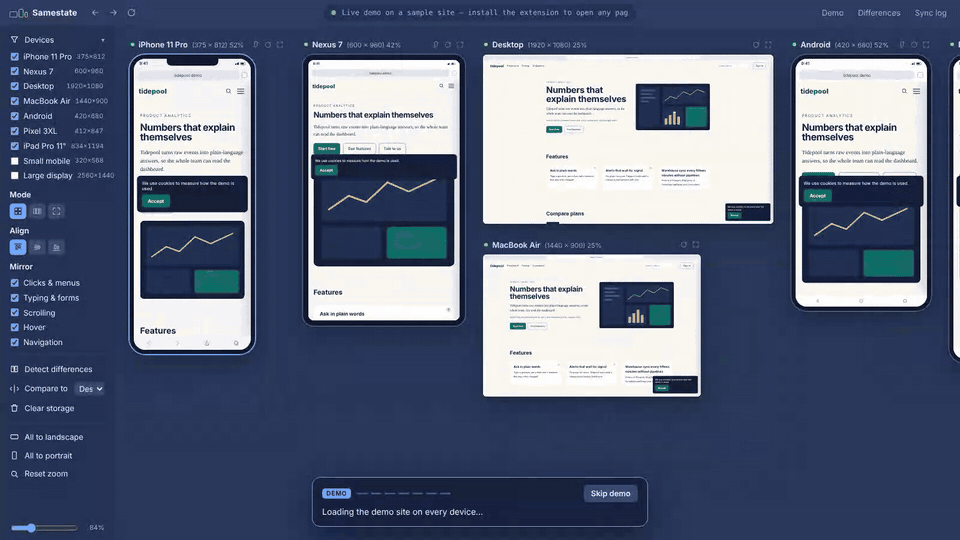
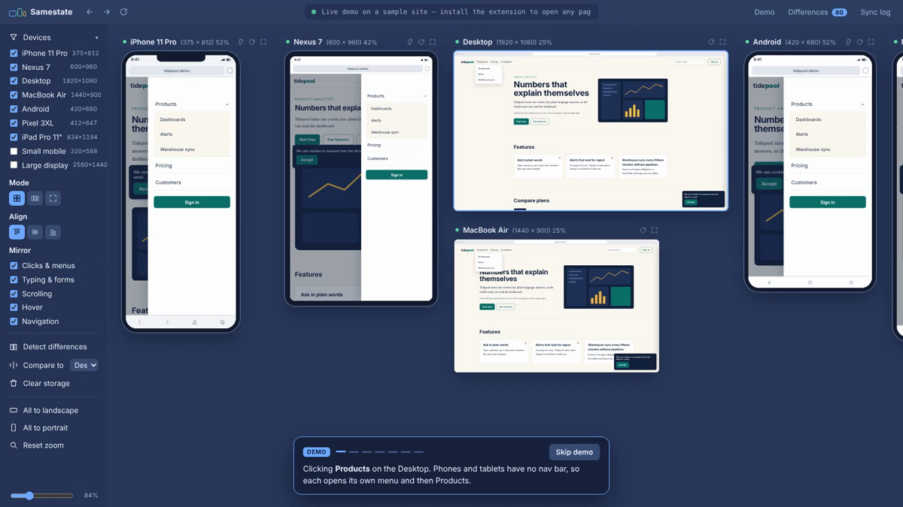
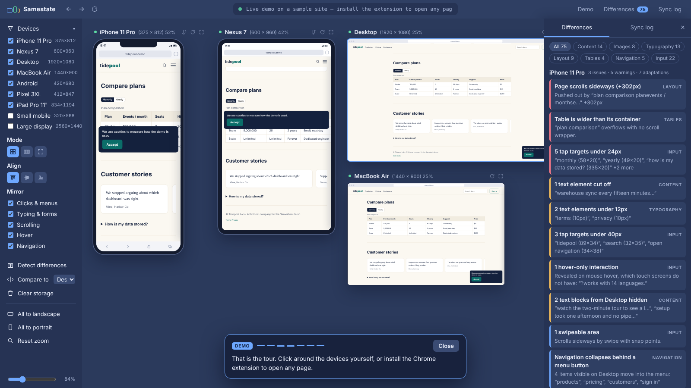

<h1 align="center">Samestate</h1>
<p align="center"><b>One interaction, every device.</b><br>
Click once. Every screen size follows to the same state, even when the layouts are completely different.</p>

<p align="center">
  <a href="https://shouvik12.github.io/samestate/"><b>▶ Live demo</b></a> ·
  <a href="#install">Install the Chrome extension</a> ·
  <a href="#how-it-works">How it works</a> ·
  <a href="#release-notes">Release notes</a>
</p>

<p align="center"><a href="https://shouvik12.github.io/samestate/"></a></p>

## Screenshots

| Logical sync | Difference report |
|---|---|
|  |  |
| Desktop clicks **Products**. Each phone opens its own drawer, then Products. | Every device measured against the Desktop, grouped by category. |

## What it does

Samestate opens a site in a wall of responsive previews for phones, tablets, laptops, and desktops.

- **Device presets.** Choose from 83 built-in viewports or save a custom size.
- **Click and scroll sync.** Samestate matches controls and scroll sections by their position in the page structure.
  Enable **Match visible text** to help match controls and compare content when layouts use different markup.
  The bundled demo also maps the desktop Products menu to the phone’s navigation drawer.
- **Video playback.** Play or pause the main video across the wall from the **Sync** drawer.
- **Difference report.** Every device is measured against a reference device. **By issue** lists each problem
  once with the screens it affects; click it to outline the elements on all of them, or click a screen to see
  its details. **By device** lists every screen's findings separately.
- **Sync log.** Shows which devices matched, skipped, or could not reach a control.
- **Screenshots and recordings.** Save the visible device wall as a PNG or a silent WebM video.

### What the report catches

| Category | Examples |
|---|---|
| Layout | Page scrolls sideways, side-by-side blocks that stack, text touching the screen edge |
| Navigation | Nav collapses behind a menu button, or items that vanish with no way to reach them |
| Content | Text and controls hidden on smaller screens, cut-off text |
| Images | Changed shape, stretched or broken images |
| Typography | Type scale changes, text under 12px |
| Tables | Tables wider than the screen, tables that need a sideways swipe |
| Input | Tap targets under 24px and 40px |
| Usability | Overlays that sit on top of buttons (cookie banners), missing viewport tag |

## Install

Samestate is a Chrome extension. No server and no terminal.

1. Download this repo (**Code → Download ZIP**) and unzip it.
2. Open `chrome://extensions`.
3. Turn on **Developer mode** (top right).
4. Click **Load unpacked** and choose the `extension` folder **inside** the unzipped repo
   (the one that contains `manifest.json`), not the repo's top-level folder.
5. Pin the Samestate icon from the puzzle-piece menu.

Click the Samestate icon to open the preview tab. It starts with `claude.com` on every screen. To preview
another site, enter its address and grant Chrome access to that site. The **Demo** button plays a guided demo on a
sample site that walks through sync, the difference report, annotations, video playback, free placement, themes,
Page steps and Compare sites. A pointer performs each action, with the explanation beside the control it uses.

## Choose devices and options

Open **Devices** to browse Android phones, Apple phones, tablets, and specials such as foldables, watches, and TVs. Search by model or dimensions, or turn on **Selected only** to edit the current wall. Under **My custom devices**, enter a name, width, height, and frame type to save a preset in this browser.

Click **×** in a preview’s title bar to close it. Select the device again in **Devices** to reopen it.

**Capture**, **Views**, **Layout**, **Sync**, and **Compare** each open and close independently. Use the toolbar’s sidebar button to hide or reopen the panel.

Dimensions are CSS viewport presets for testing layouts in Chrome. The catalog uses the [Mobile FIRST viewport reference](https://www.webmobilefirst.com/en/devices/) and [Apple’s display guidance](https://developer.apple.com/cn/design/human-interface-guidelines/layout), including the [iPhone 18 Pro specifications](https://www.apple.com/iphone-18-pro/specs/).

## Compare devices and page steps

- In **Views → Device sizes**, choose **Different devices** to use the selected presets or **Same device on every screen** to give those previews one shared size. Select **Device for all previews** to resize them in place.
- Turn on **Views → Page steps** to start a row with the page you originally opened. Follow a same-origin link or use a supported control, such as **Sign in**, to open the next state beside the current screen. Dialogs, menus and tabs can become steps even when the address stays the same. In the extension, you can also enter a path such as `/pricing` in the address bar. Close a step with **×** in its header.
- To switch sites, enter a domain or full URL in the address bar. After Chrome grants access, the new site opens at Step 1 with the selected device size.
- To see the same steps at laptop size, select a preset such as **MacBook Air** under **Device for all previews**. Turn **Page steps** off to return to the device wall. Your open previews are kept when you switch between the two views.
- Drag a preview by its title bar to place it anywhere on the wall. In **Layout**, use **Lock layout** to keep previews in place or choose **Row** or **Grid** to restore automatic placement. Each view keeps its own arrangement.

When previews extend beyond the visible wall, drag the scrollbar at the bottom to move left or right. The bar is available with the sidebar closed.

Click the percentage in a preview’s title bar to change its display scale. Choose **100% (CSS px)** to display the page at its viewport dimensions, enter a custom percentage, or choose **Auto** to follow the wall zoom or Focus fit again. The dimensions apply to the webpage area inside the frame. Its physical size depends on the display and system scaling.

To match a device on your monitor, open the preview’s percentage menu and expand **Physical size**. Measure the blue line with a ruler, enter its length in millimetres, then choose **Match size**. The iPhone 11 Pro uses its published screen and body dimensions. For other presets, enter the width of the device’s lit display. Measure the line again after changing monitors, Chrome zoom, or system display scaling. [iPhone 11 Pro specifications](https://support.apple.com/en-us/111879)

## Compare websites side by side

Click **Compare sites** in the toolbar. Two device walls open side by side, with the current site loaded on every device in both walls. Enter a different address in either column to update all of its devices. Use **+ Add site** for more walls. The **Viewport** menu defaults to **All devices**, with options for one responsive or fixed-size preview.

Click **Compare sites** again to return to the device wall. The open site columns, devices, and page steps stay loaded when you switch. Chrome asks for access when you open a new site. The hosted demo starts both walls on its bundled home page.

Scroll outside the webpages to move the site walls up or down together. Use the sidebar to select devices, change the layout, or capture the visible comparison. Sync and difference reports work within each site's device previews. The **Page steps** control opens the journey view on the device wall.

## Annotate previews

Click the pencil in a preview’s title bar. Choose **Draw**, **Line**, or **Arrow**, then drag over the page. Choose **Note**, click where it belongs, and save your text. Click a note while the Note tool is active to edit it. Use **Erase** to remove a mark or note.

Click the pencil again to interact with the webpage while keeping the marks visible. Annotations belong to the individual preview in the current tab, including in **Page steps** and **Compare sites**. They follow the preview when it moves or resizes and appear in wall captures.

## Preview a color theme

Open **Theme** in the sidebar. Under **Apply to**, choose a preview, a **Compare sites** column, or all visible previews. Pick a **tweakcn preset** by name to load and apply it automatically. Use **Light**, **Dark**, or **Follow site** to switch palettes.

Sites that use shadcn color and radius variables can pick up the theme directly. **Recolor basic elements** also changes the page background, text, links, buttons, and input borders on sites with hard-coded styles. In **Compare sites**, apply the theme to one column to see it beside the original.

For your own design, choose **Custom CSS…**, paste the CSS export, and click **Apply theme**. Themes use supported color and radius values and stay in the current Samestate tab. Click **Reset** to restore the selected previews. [tweakcn editor](https://tweakcn.com/editor/theme)

## Capture the device wall

With a preview open in desktop Chrome, click **Screenshot** or **Record**, then share the current Samestate tab in Chrome’s picker. **Screenshot** starts a PNG download. **Record** starts a silent video, and **Stop** downloads it as WebM. You can take screenshots while recording.

Capture follows the visible part of the wall as you scroll or zoom. In **Compare sites**, the crop includes the visible site columns together. Samestate saves the files locally.

## Export the difference report

After **Detect differences**, open **Export** in the Differences panel and choose a format. Every finding is exported, whichever category filter is selected.

- **Markdown** for pasting into an issue or a pull request, with each problem once and a line per affected screen.
- **CSV** with one row per finding and screen, for spreadsheets and bug trackers.
- **HTML page**, a single file that opens in any browser.
- **HTML with screenshots** adds a cropped screenshot of the affected screen to each finding, with the elements outlined. Share the current Samestate tab when Chrome asks. Samestate shows each screen on its own in Focus mode while it takes the screenshots, then returns to your layout. This option is on the device wall only, not in **Compare sites**.

## Save and reopen a setup

Open **Workspaces** in the sidebar, enter a name, and click **Save**. A workspace keeps the site, the selected devices and their rotation, scale and link state, the layout (mode, zoom, alignment, lock and dragged positions), **Views** settings and page steps, **Compare sites** columns, sync settings, themes and annotations. Click **Open** to return to it; Chrome asks once for any sites that need access. Saving under an existing name replaces it.

The setup in use when the Samestate tab closes is kept as **Last session**. Workspaces are stored in this browser only. Dragged positions in comparison columns are not saved.

## Sync video playback

Open the video’s page directly in Samestate, then open **Sync** and click **Play all** or **Pause all**. With **Video playback** checked, playing or pausing in one linked preview also updates the other linked previews.

If Chrome blocks playback with sound, Samestate tries again muted. The Sync log shows the result for each preview. Players embedded from a different site need to be opened on their own page for Samestate to control them.

## Chrome extension privacy

Samestate uses element structure, visibility, and layout measurements to produce its reports. **Match visible text**
is off when you open a preview. When enabled, the preview reads rendered text locally and uses temporary
fingerprints for comparison. Raw page text stays out of the report and sync log. Visible text can contain
personal data. Mark elements with `data-samestate-private` to exclude their text from matching.

Form fields, editable regions, page titles, cookies, and site storage are excluded from inspection. Form input
and submissions stay in the preview where you use them. **Page steps** uses the destination of a same-origin link
or the structure of a supported control to open the next preview. Samestate scopes inspection to the device wall’s site.
**Compare sites** applies the same inspection rules to each opened site and mirrors interactions only within that site’s column. Live previews start with separate, temporary browser storage and do not reuse existing sign-ins.

## How it works

```
extension/
  background.js   Lets opened origins load inside a Samestate tab and connects the device wall agent.
  agent.js        Measures layout and mirrors interactions using element positions and control types.
  app.html/js/css The device wall, site comparison, message router, sync log, and difference engine.
  devices.js      Device presets, search, and custom device settings.
  annotations.js  Notes, strokes, lines, and arrows on individual previews.
  themes.js       Loads tweakcn presets, parses custom CSS, and builds preview styles.
  capture.js      Local screenshots and recordings of the device wall.
  report.js       Exports the difference report as Markdown, CSV or HTML.
  workspaces.js   Saves and reopens setups in the browser's local storage.
  demo/           The sample site used by the guided demo.
docs/             The same app as a static page for the live demo (GitHub Pages).
tests/smoke.mjs   Plays the guided demo in headless Chrome and checks each step.
```

Run the smoke test with Node 22 or later and Chrome installed: `node tests/smoke.mjs`. It needs no packages, takes about two minutes, and runs on every push and pull request to `main`.

## Known limits

- Clicks and report comparisons can miss matches when a site uses different markup and text across screen sizes.
- Device frames have the device's size but send your browser's own user-agent. Sites that pick a
  mobile layout on the server by user-agent will show desktop markup.
- CSS `hover` / `pointer` media queries and device pixel ratio report your real computer.
- Security headers are removed inside Samestate tabs so pages can be framed. Use those tabs for
  previewing, not for sensitive browsing. Other tabs are untouched.

## Roadmap

- Chrome Web Store listing
- Per-device user-agent in the extension

## Release Notes

Each change has a file in [`changelogs/`](changelogs/) with the details. Commit times include the UTC offset recorded by Git.

| Date | Commit time | Commits | Feature / Update |
|------|-------------|---------|------------------|
| **2026-11-13** | — | — | **Saved workspaces** — save the current setup under a name and reopen it, with the last session kept automatically ([details](changelogs/CHANGELOG-saved-workspaces.md)) |
| **2026-11-13** | — | — | **Report export** — export the difference report as Markdown, CSV or HTML, optionally with a screenshot per finding ([details](changelogs/CHANGELOG-report-export.md)) |
| **2026-11-13** | — | — | **Smoke test** — `tests/smoke.mjs` plays the guided demo in headless Chrome and checks every step, on each push and pull request ([details](changelogs/CHANGELOG-smoke-test.md)) |
| **2026-11-13** | 02:29:23 +09:00 | `34199be` | **Grouped findings** — the difference report lists each problem once with the screens it affects, with **By device** for the per-screen list ([details](changelogs/CHANGELOG-grouped-findings.md)) |
| **2026-11-13** | 02:02:13 +09:00 | `c9dde7a` | **Address placeholder** — the address bar's example is just `https://your-site.com`, without `localhost:3000` ([details](changelogs/CHANGELOG-address-placeholder.md)) |
| **2026-11-13** | 01:14:00 +09:00 | `e4d22de` | **Demo tour pointer** — a pointer performs each demo action, with the explanation beside the control and a result label on every preview ([details](changelogs/CHANGELOG-demo-tour-pointer.md)) |
| **2026-11-13** | 00:48:00 +09:00 | `4fc0889` | **Demo tour features** — the guided demo now shows every feature added since the first release, pointing at each control it uses ([details](changelogs/CHANGELOG-demo-tour-features.md)) |
| **2026-11-12** | 23:50:19 +09:00 | `af3e2d3` | **Preview themes** — pick a named tweakcn preset to apply it automatically to previews ([details](changelogs/CHANGELOG-preview-themes.md)) |
| **2026-11-12** | 23:13:07 +09:00 | `628629b` | **Preview annotations** — add notes, drawings, lines, and arrows to any preview ([details](changelogs/CHANGELOG-preview-annotations.md)) |
| **2026-11-12** | 22:51:33 +09:00 | `aca3c1e` | **Compare sites controls** — linked wall scrolling, sidebar controls, screenshots, and recordings ([details](changelogs/CHANGELOG-compare-sites-controls.md)) |
| **2026-11-12** | 22:51:33 +09:00 | `aca3c1e` | **Compare sites** — open several websites on side-by-side device walls ([details](changelogs/CHANGELOG-compare-sites.md)) |
| **2026-11-12** | 22:51:33 +09:00 | `aca3c1e` | **Physical preview size** — calibrate a preview to the size of a real device on your monitor ([details](changelogs/CHANGELOG-physical-preview-size.md)) |
| **2026-11-12** | 22:51:33 +09:00 | `aca3c1e` | **Per-preview scale** — click a preview’s percentage to set its display scale ([details](changelogs/CHANGELOG-preview-scale.md)) |
| **2026-11-12** | 20:57:34 +09:00 | `59b09a1` | **Close device previews** — close individual screens from the device wall ([details](changelogs/CHANGELOG-close-device-previews.md)) |
| **2026-11-12** | 20:57:34 +09:00 | `59b09a1` | **Preview borders** — each preview and its title-bar controls share a visible border ([details](changelogs/CHANGELOG-preview-borders.md)) |
| **2026-11-12** | 20:57:34 +09:00 | `59b09a1` | **Switch sites in Page steps** — enter another domain or URL to start a new journey ([details](changelogs/CHANGELOG-switch-preview-site.md)) |
| **2026-11-12** | 20:57:34 +09:00 | `59b09a1` | **Page step placement** — drag steps by their title bars while keeping their page states and step numbers ([details](changelogs/CHANGELOG-page-step-placement.md)) |
| **2026-11-12** | 20:57:34 +09:00 | `59b09a1` | **Wall scrollbar** — drag the bottom bar to reach previews on either side ([details](changelogs/CHANGELOG-wall-scrollbar.md)) |
| **2026-11-12** | 20:57:34 +09:00 | `59b09a1` | **Views and page steps** — use one shared device size across the wall or open successive pages and supported interaction states side by side ([details](changelogs/CHANGELOG-page-views.md)) |
| **2026-11-12** | 20:57:34 +09:00 | `59b09a1` | **Video playback sync** — play and pause the main video across previews, with per-device results ([details](changelogs/CHANGELOG-video-playback.md)) |
| **2026-11-12** | 20:57:34 +09:00 | `59b09a1` | **Device drawers** — reorganized the sidebar and added 83 searchable presets plus locally saved custom devices ([details](changelogs/CHANGELOG-device-drawers.md)) |
| **2026-11-12** | 20:57:34 +09:00 | `59b09a1` | **Wall capture** — save the visible device wall as a PNG screenshot or a silent WebM recording ([details](changelogs/CHANGELOG-wall-capture.md)) |
| **2026-11-12** | 18:05:50 +09:00 | `82deac7` | **Free placement** — drag a screen by its title bar to any spot on the wall, such as a phone between two laptops; Grid or Row returns to the automatic layout, and Lock layout keeps the arrangement ([details](changelogs/CHANGELOG-free-placement.md)) |
| **2026-11-12** | 17:36:29 +09:00 | `86b6a1d` | **Default site** — Samestate opens `claude.com` on every screen at start-up, with access built into the manifest; the guided demo moves to the Demo button ([details](changelogs/CHANGELOG-default-site.md)) |
| **2026-11-12** | 17:32:12 +09:00 | `d14d868` | **Arrange screens** — drag a screen by its title bar onto another to move it, and lock the layout so it stays put; the arrangement resets when the Samestate tab is reopened ([details](changelogs/CHANGELOG-arrange-screens.md)) |
| **2026-11-12** | 17:32:12 +09:00 | `d14d868` | **Device pointers** — phone and tablet screens show a fingertip circle instead of the mouse arrow; desktop and MacBook screens show a white mouse arrow ([details](changelogs/CHANGELOG-touch-pointer.md)) |
| **2026-11-12** | 17:24:58 +09:00 | `0185838` | **Changelog setup** — one `changelogs/CHANGELOG-<topic>.md` per change, a pre-commit hook and a CI check that require one for code changes, and this table ([details](changelogs/CHANGELOG-changelog-setup.md)) |
| **2026-11-12** | 17:19:19 +09:00 | `f631c39` | **Demo sandbox warning** — the bundled demo frame loads without a sandbox, which Chrome warned could not isolate a same-origin page; real sites keep it ([details](changelogs/CHANGELOG-demo-sandbox.md)) |
| **2026-11-12** | 17:19:19 +09:00 | `f631c39` | **Twin control matching** — a control the site renders twice (desktop bar and mobile bar) is paired by its attributes, so a day/night toggle clicked on a phone reaches the desktops; toggles already in the target state are skipped ([details](changelogs/CHANGELOG-twin-control-matching.md)) |
| **2026-11-12** | 17:19:19 +09:00 | `f631c39` | **Align screens** — one button brings every linked screen to the page and scroll position of the screen used last; a link toggle on each screen chooses which screens move together ([details](changelogs/CHANGELOG-align-screens.md)) |
| **2026-11-12** | 17:19:19 +09:00 | `f631c39` | **Redirect follow** — a site that redirects to another hostname (`example.com` → `www.example.com`) reopens there instead of showing blank frames ([details](changelogs/CHANGELOG-redirect-follow.md)) |
| **2026-11-12** | 17:19:19 +09:00 | `f631c39` | **Per-site access** — the extension asks Chrome for one site at a time instead of all sites, limits header removal and inspection to that site, and matches controls by page structure with optional visible-text matching ([details](changelogs/CHANGELOG-per-site-access.md)) |
| **2026-11-12** | 16:47:15 +09:00 | `35d7207` | **Node server removed** — dropped the optional local proxy, whose `/api/open` endpoint accepted requests from any web page ([details](changelogs/CHANGELOG-remove-node-server.md)) |
| **2026-11-12** | 08:50:47 +05:30 | `42fc89c` | **Contributing guide** added |
| **2026-11-12** | 00:12:48 +05:30 | `a264396` | **README** — screenshots, and which folder to load in Chrome |
| **2026-11-11** | 23:59:55 +05:30 | `63cb071` | **First release** |

## License

MIT © Souvik Palit
